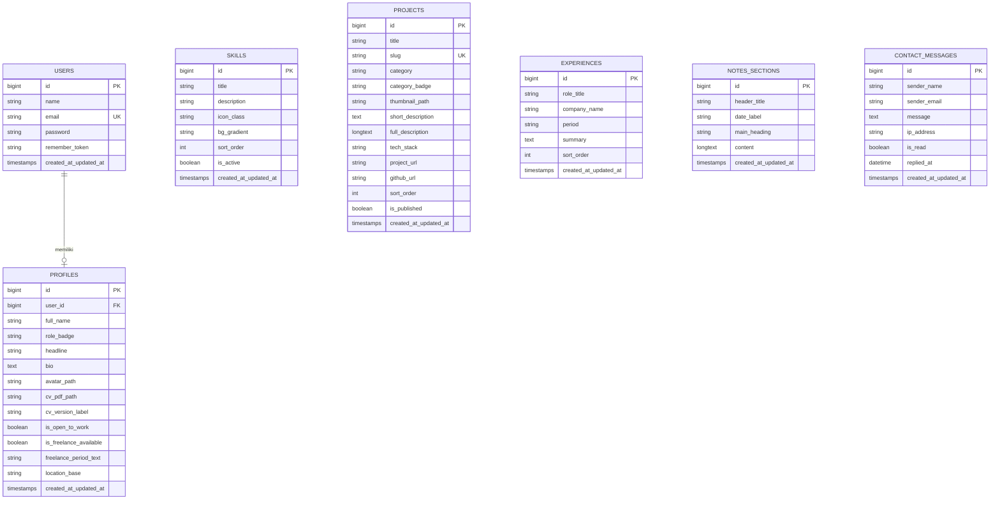
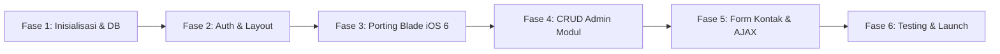

# Product Requirements Document (PRD)
## Web Portofolio Personal Berbasis Skeuomorphic iOS 6 dengan Admin Dashboard

---

## 1. Ringkasan Eksekutif & Gambaran Proyek

### 1.1 Gambaran Umum
Proyek ini adalah pengembangan website portofolio interaktif dengan konsep desain retro-skeuomorphic khas **iOS 6 Classic Edition** (linen texture, glassy squircle icons, glossy buttons, pinstripe sheets, dan skeuomorphic notes app). Seluruh konten statis yang ada pada template desain diubah menjadi **dinamis** dan dapat dikelola langsung oleh pemilik portofolio melalui **Web Dashboard Admin** yang terproteksi autentikasi (login).

### 1.2 Tujuan Proyek
1. **Showcase Interaktif & Berkarakter**: Memikat calon klien, rekruiter, atau pengunjung dengan UI skeuomorphic iOS 6 yang taktil, responsif, dan kaya mikro-interaksi.
2. **Kemandirian Konten (CMS)**: Pemilik dapat menambah, mengubah, mengurutkan, dan menghapus proyek, keahlian, riwayat karier, profil, serta mengunduh/mengganti file CV PDF tanpa harus menyentuh kode program.
3. **Penerimaan Pesan Kontak Terpusat**: Form pesan langsung masuk ke database MySQL dan dapat ditinjau melalui dashboard admin.
4. **Performa & Keamanan Tinggi**: Memanfaatkan arsitektur **Laravel 13** dan **MySQL** dengan proteksi CSRF, validasi upload file ketat, serta otentikasi admin berbasis sesi.

---

## 2. Arsitektur Sistem & Spesifikasi Teknologi

| Komponen | Teknologi / Library | Catatan |
| :--- | :--- | :--- |
| **Backend Framework** | **Laravel 13** (PHP 8.3+) | Arsitektur MVC, Eloquent ORM, Form Request, Blade Engine |
| **Database** | **MySQL 8.x** | Relasional, InnoDB, UTF8mb4 |
| **Authentication** | **Laravel Breeze** (Blade Stack) / Auth bawaan | Sesi berbasis cookie aman, proteksi brute-force |
| **Frontend Public** | **Laravel Blade + Tailwind CSS + Vanilla JS** | Porting dari template HTML iOS 6, Google Font *Geist*, FontAwesome 6 |
| **Admin UI** | **Tailwind CSS Admin UI** (atau Laravel Filament) | Tampilan bersih, tabel data, form upload gambar/file |
| **File Storage** | Laravel Local/Public Storage (`storage/app/public`) | Symlink ke `public/storage` untuk foto profil, thumbnail proyek, dan file CV PDF |
| **Security Layer** | CSRF Protection, XSS Sanitization, File MIME Verification, Rate Limiting | Melindungi endpoint login dan form kontak publik |

---

## 3. Diagram Arsitektur & Alur Data

```mermaid
flowchart TD
    subgraph Publik ["Area Publik (Pengunjung)"]
        A[Pengunjung Web] -->|Akses URL /| B[PublicController@index]
        B -->|Ambil Data Aktif| DB[(MySQL Database)]
        B -->|Render Tampilan| C[Blade View: iOS 6 Classic Layout]
        A -->|Kirim Pesan Kontak| D[ContactController@store]
        D -->|Validasi & Simpan| DB
        A -->|Klik Unduh CV| E[DownloadController@downloadCV]
        E -->|Stream File PDF| Storage[(File Storage / Public)]
    end

    subgraph AdminArea ["Area Terproteksi (Admin)"]
        Admin[Pemilik / Admin] -->|Akses /admin/login| AuthGuard[Laravel Auth Middleware]
        AuthGuard -->|Kredensial Valid| Dash[Admin Dashboard]
        Dash -->|Kelola Profil & CV| CtrlProfile[ProfileController]
        Dash -->|CRUD Proyek| CtrlProjects[ProjectController]
        Dash -->|CRUD Keahlian| CtrlSkills[SkillController]
        Dash -->|CRUD Riwayat Karier| CtrlExp[ExperienceController]
        Dash -->|Tinjau Pesan Masuk| CtrlInbox[MessageController]
        CtrlProfile & CtrlProjects & CtrlSkills & CtrlExp & CtrlInbox --> DB
        CtrlProfile & CtrlProjects --> Storage
    end
```

---

## 4. Struktur Database & Model Data (ERD)



### Rincian Tabel & Migrasi:

#### 1. `users`
- Menyimpan akun login admin (email, password hash Bcrypt/Argon2).

#### 2. `profiles`
- Menyimpan data profil utama yang ditampilkan pada **Hero Section**:
  - `full_name`: misal "Raka Pratama"
  - `role_badge`: misal "Product Designer & Frontend Engineer"
  - `headline`: teks sapaan ("Halo, Saya Raka Pratama")
  - `bio`: teks deskripsi profil
  - `avatar_path`: path foto profil di storage
  - `cv_pdf_path`: path file PDF resume
  - `cv_version_label`: misal "v6.1.3"
  - `is_open_to_work`: status badge (OPEN TO WORK)
  - `is_freelance_available`: status toggle ketersediaan kerja (ON/OFF)
  - `freelance_period_text`: misal "Tersedia untuk Q4 2026"
  - `location_base`: misal "Jawa Timur, Indonesia (WIB)"

#### 3. `skills`
- Data ikon pada **Home Screen App Grid**:
  - `title`: misal "UI/UX Design"
  - `description`: "Figma, Prototyping, Design Systems"
  - `icon_class`: nama kelas FontAwesome (e.g. `fa-solid fa-pen-nib`)
  - `bg_gradient`: opsi skema warna gradient iOS 6 (e.g., Sky-Blue, Amber-Orange, Lime-Green)
  - `sort_order`: urutan tampil

#### 4. `projects`
- Data kartu pada **Portfolio Showcase**:
  - `title`: nama proyek yang dikelola admin
  - `category`: `app` | `web` | `mobile` (untuk segmented control filter)
  - `category_badge`: label overlay (misal "iOS & Web App", "Web Audio")
  - `thumbnail_path`: foto cover proyek
  - `short_description`: rangkuman singkat pada kartu
  - `full_description`: penjelasan lengkap untuk modal popup
  - `tech_stack`: daftar teknologi (e.g., "React • TypeScript • Tailwind")
  - `project_url` & `github_url`: tautan eksternal demo/repo
  - `sort_order` & `is_published`: kontrol urutan dan status tayang

#### 5. `experiences`
- Menampilkan rekam jejak karier pada **Notes App Section**:
  - `role_title`: misal "Lead UI Engineer"
  - `company_name`: misal "Studio Nusantara"
  - `period`: misal "2023 – Sekarang"

#### 6. `notes_sections`
- Konten editorial filosofi kerja ala kertas buku catatan bergaris iOS 6:
  - `header_title`: "Catatan Karier & Filosofi"
  - `date_label`: tanggal catatan (default otomatis/manual)
  - `main_heading`: judul artikel singkat
  - `content`: paragraf filosofi desain

#### 7. `contact_messages`
- Menampung masukan dari modal pesan:
  - `sender_name`, `sender_email`, `message`, `ip_address`, `is_read`

---

## 5. Rincian Fitur & Kebutuhan Fungsional

### 5.1 Halaman Publik (Frontend Portofolio)

#### A. Hero & Profil (iOS 6 Sheet Style)
- Tampilan foto profil dengan efek squircle glossy iOS 6.
- Menampilkan nama, badge status ketersediaan kerja, dan bio dinamis dari database.
- Tombol aksi:
  - **Jelajahi Proyek**: Melakukan smooth scroll ke section `#projects`.
  - **Kirim Pesan**: Membuka dialog modal kontak UIAlertView.
  - **Slide-to-Unlock CV**: Tombol interaktif untuk mengunduh file PDF resume yang diupload admin.

#### B. Home Screen App Grid (Keahlian & Teknologi)
- Tampilan grid ikon 6 aplikasi dengan glossy overlay lengkung khas iOS 6.
- Efek hover skeuomorphic (`scale(1.06)` dan shadow lembut).
- Klik pada ikon memicu **Notification Banner** gelap di bawah grid yang menampilkan judul dan rincian teknologi yang digunakan.

#### C. Portfolio Showcase (Grouped Table View)
- Segmented Control filter: **Semua**, **App**, **Web** (berfungsi instan secara client-side JS / AJAX).
- Kartu proyek bergaya pinstripe sheet dengan thumbnail beresolusi tajam.
- Tombol **Detail**: Membuka modal UIAlertView kaca biru tua berisi deskripsi lengkap, rincian tech stack, serta tombol link demo.

#### D. Preferensi & Ketersediaan Kerja
- Grouped list item menampilkan status ketersediaan freelance dan basis lokasi.
- Switch toggle interaktif bergaya iOS 6 (ON warna biru cerah / OFF warna abu-abu netral) mencerminkan status asli dari database.

#### E. Notes App (Filosofi & Pengalaman Karier)
- Desain kertas kuning bergaris dengan pembatas merah margin kiri dan header kulit cokelat (*leather header*).
- Menampilkan tulisan reflektif/filosofi dan daftar pengalaman kerja yang dinamis.

#### F. Form Kontak (iOS 6 Alert View Modal)
- Dialog box biru gelap semi-transparan dengan sorotan kaca glossy atas.
- Validasi form (Nama, Email, Pesan) dengan AJAX submission tanpa reload halaman.
- Pemberitahuan sukses "Pesan Terkirim!" secara elegan di dalam modal.

---

### 5.2 Area Autentikasi (Admin Login)

1. **Akses URL**: `/admin/login`.
2. **Keamanan Login**:
   - Throttle login (maksimal 5 percobaan gagal per menit).
   - Form CSRF token wajib.
   - Fitur "Ingat Saya" (*Remember Me*).
   - Sesi terenkripsi dan proteksi proteksi `HttpOnly` cookie.
3. **Logout**: Form POST dengan token CSRF ke `/admin/logout`.
4. **Manajemen Akun**: Fitur ubah kata sandi dan profil akun admin.

---

### 5.3 Area Dashboard Admin

Tampilan dashboard admin dirancang responsif, bersih, dan cepat digunakan untuk mengelola seluruh aspek portofolio:

#### Modul 1: Ringkasan Dashboard (Overview)
- Metrik kartu: Total Proyek, Total Keahlian, Total Pesan Masuk, Jumlah Pesan Belum Dibaca.
- Quick switch ketersediaan kerja (Open to Work / Freelance).
- Log pesan kontak terbaru.

#### Modul 2: Kelola Profil & Resume CV
- Form input nama lengkap, role badge, judul intro, dan bio.
- Upload foto avatar (validasi JPG/PNG/WebP, crop preview otomatis).
- Upload file CV resume (validasi file PDF, maks 10MB).
- Pengaturan versi resume (e.g. `v6.1.3`) dan lokasi basis.
- Toggle status ketersediaan freelance & status "Open to Work".

#### Modul 3: Kelola Proyek (CRUD)
- **Tabel Daftar Proyek**: Thumbnail, Judul, Kategori, Status Tayang, Aksi.
- **Tambah / Edit Proyek**:
  - Input judul proyek & slug otomatis.
  - Pilihan kategori (`App`, `Web`, `Other`).
  - Label badge kategori (misal: `iOS & Web App`).
  - Upload thumbnail gambar (disimpan di storage publik).
  - Input deskripsi singkat dan deskripsi detail.
  - Tag teknologi (dipisahkan koma).
  - Tautan proyek (URL Demo & URL GitHub).
  - Status Publikasi (Draft / Publish).
  - Urutan tampilan (*Sort Order*).
- **Hapus Proyek**: Dilengkapi konfirmasi modal dialog.

#### Modul 4: Kelola Keahlian / App Grid (CRUD)
- Tambah ikon keahlian baru.
- Pilihan ikon FontAwesome (misal `fa-code`, `fa-pen-nib`, dll).
- Pemilihan preset gradient warna glossy iOS 6 (Sky Blue, Amber Red, Lime Green, Purple Fuchsia, Slate Grey, Rose Red).
- Pengaturan judul keahlian dan daftar tools.
- Urutan tampilan (*drag-and-drop* atau input angka urutan).

#### Modul 5: Kelola Catatan Filosofi & Karier (CRUD)
- Form edit teks Notes App (Header, Judul Catatan, Isi Filosofi).
- CRUD Kartu Pengalaman Karier (Jabatan, Nama Perusahaan, Tahun/Periode, Ringkasan).

#### Modul 6: Kotak Masuk Pesan Kontak (Inbox)
- Tampilan list pesan masuk dengan badge status **Belum Dibaca** / **Sudah Dibaca**.
- Detail pesan: Nama pengirim, email (klik untuk membalas via mailto), waktu kirim, isi pesan lengkap.
- Aksi hapus pesan atau tandai sudah dibaca.

---

## 6. Kebutuhan Non-Fungsional (NFR)

1. **Performa**:
   - First Contentful Paint (FCP) < 1.2 detik.
   - Caching untuk data profil dan daftar proyek publik (`Cache::remember`).
   - Kompresi gambar thumbnail proyek secara otomatis atau penyajian WebP.
2. **Keamanan**:
   - Sanitasi input form terhadap XSS dan SQL Injection via Eloquent PDO.
   - Pembatasan file upload: Avatar (max 2MB, image/jpeg, image/png, image/webp), CV (max 10MB, application/pdf).
   - Middleware `auth` pada seluruh route berawalan `/admin/*`.
3. **SEO & Metadata**:
   - Tag OpenGraph dinamis (og:title, og:description, og:image mengambil dari avatar profil/proyek unggulan).
   - Sitemap XML otomatis untuk perayapan mesin pencari.
4. **Responsivitas**:
   - Tampilan sempurna pada layar smartphone (360px+), tablet, hingga desktop resolusi tinggi tanpa merusak estetika skeuomorphic.

---

## 7. Struktur Folder Proyek Laravel 13

```text
portfolio-me/
├── app/
│   ├── Http/
│   │   ├── Controllers/
│   │   │   ├── PublicController.php         // Menampilkan halaman publik portofolio
│   │   │   ├── ContactMessageController.php // Menangani AJAX form kontak
│   │   │   └── Admin/
│   │   │       ├── DashboardController.php  // Ringkasan metrik admin
│   │   │       ├── ProfileController.php    // Kelola data profil & CV
│   │   │       ├── ProjectController.php    // CRUD Proyek
│   │   │       ├── SkillController.php      // CRUD Keahlian
│   │   │       ├── ExperienceController.php // CRUD Pengalaman kerja
│   │   │       ├── NotesController.php      // Pengaturan Notes App
│   │   │       └── MessageController.php    // Kelola pesan masuk
│   │   └── Requests/                        // Form Request Validations
│   └── Models/
│       ├── User.php
│       ├── Profile.php
│       ├── Skill.php
│       ├── Project.php
│       ├── Experience.php
│       ├── NotesSection.php
│       └── ContactMessage.php
├── database/
│   ├── migrations/                          // Skema seluruh tabel
│   └── seeders/
│       ├── DatabaseSeeder.php
│       └── PortfolioSeeder.php              // Seeder data default dari template HTML
├── resources/
│   └── views/
│       ├── layouts/
│       │   ├── app.blade.php                // Layout publik iOS 6
│       │   └── admin.blade.php              // Layout dashboard admin
│       ├── public/
│       │   └── index.blade.php              // Halaman utama portofolio
│       └── admin/
│           ├── dashboard.blade.php
│           ├── profile/index.blade.php
│           ├── projects/
│           │   ├── index.blade.php
│           │   ├── create.blade.php
│           │   └── edit.blade.php
│           ├── skills/index.blade.php
│           ├── experiences/index.blade.php
│           └── messages/index.blade.php
├── routes/
│   ├── web.php                              // Route publik & admin
│   └── auth.php                             // Route login, logout, password
└── storage/
    └── app/
        └── public/
            ├── avatars/
            ├── resumes/
            └── projects/
```

---

## 8. Rencana Implementasi & Roadmap Pengembangan



- **Fase 1 (Inisialisasi & Database)**:
  - Setup instalasi Laravel 13 dan koneksi database MySQL (`.env`).
  - Pembuatan migration, model, dan seeder yang memuat data contoh dari template HTML yang dilampirkan.
- **Fase 2 (Autentikasi & Kerangka Admin)**:
  - Pemasangan sistem login admin dengan proteksi session dan rate limiting.
  - Setup layout dashboard admin dengan navigasi sidebar/topbar.
- **Fase 3 (Integrasi Frontend Blade iOS 6)**:
  - Mengonversi file HTML yang dilampirkan ke dalam Blade component & view (`resources/views/public/index.blade.php`).
  - Menghubungkan variabel dinamis dari database (Profil, Keahlian, Proyek, Catatan Karier).
- **Fase 4 (Pengembangan CRUD Admin Dashboard)**:
  - Form manajemen profil, upload foto avatar, dan upload file PDF CV.
  - CRUD portofolio proyek lengkap dengan upload thumbnail.
  - CRUD keahlian & pengaturan urutan ikon.
  - Pengaturan teks refleksi/filosofi dan riwayat karier.
- **Fase 5 (Form Kontak & Interaksi Interaktif)**:
  - Integrasi form kontak dengan endpoint POST AJAX Laravel.
  - Penambahan CSRF token pada modal kontak iOS 6.
  - Fitur unduh CV nyata dari storage publik.
- **Fase 6 (Pengujian, Sanitasi & Optimasi)**:
  - Uji responsivitas di berbagai ukuran layar.
  - Uji keamanan file upload (ekstensi ganda, MIME spoofing).
  - Optimasi query SQL (Eager loading) dan aset Tailwind.
